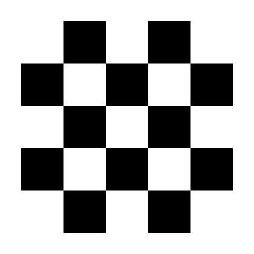

# PVA — Photovoltaic Art

New uses for end-of-life solar panels, as art.

- **[Manifesto](MANIFESTO.md)** — the principles, in English and Italian
- **Works:**
  - no. 1, [SUNDIAL](https://github.com/photovoltaic-art/SUNDIAL), Bosa, from 2027
  - no. 2, [SUNSET](https://github.com/photovoltaic-art/SUNSET), in design: nine panels as an offline network with its own currency, where every day's business closes at sunset (formerly GO TO BED; its concept, format and tests now live in the SUNSET repository)
- **Website:** [photovoltaic.art](https://photovoltaic.art) (coming)
- **[Tasks](TASKS.md)**

> Draft, October 2026. Not yet licensed for reuse.
